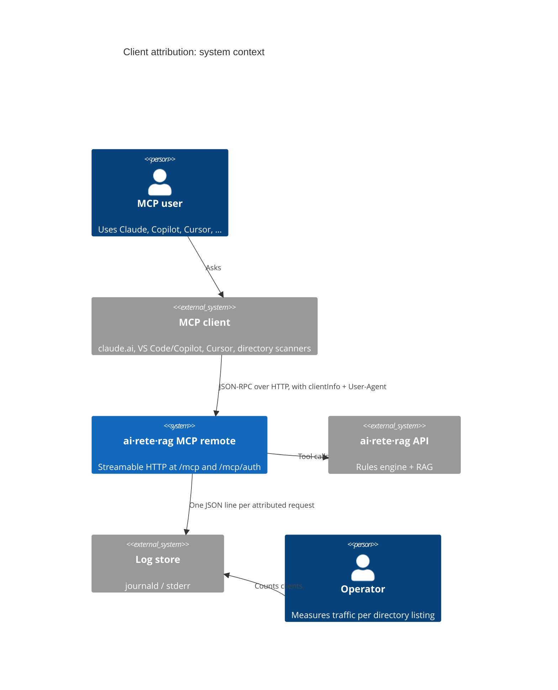
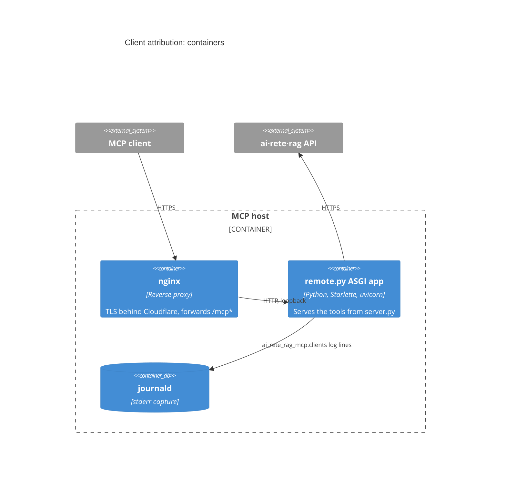
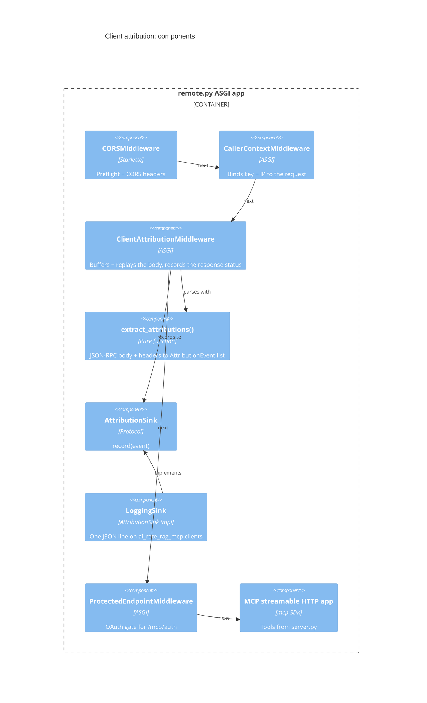

# Client attribution logging

The hosted endpoint (`/mcp` and `/mcp/auth`) writes one structured log line for
each MCP request that matters for attribution. Each line says which MCP client
made the request (Claude, VS Code / Copilot, Cursor, a directory scanner, …), so
traffic from each directory listing can be measured instead of guessed.

The stdio server does not log this. It runs on the user's own machine, so a log
written there never reaches the operator.

## What is logged

One JSON object per line, on the `ai_rete_rag_mcp.clients` logger (stderr by
default):

```json
{"event": "mcp_client", "endpoint": "/mcp", "method": "tools/call",
 "tool": "decide", "client_name": "claude-ai", "client_version": "0.1.0",
 "client_source": "meta", "user_agent": "claude-user/1.0",
 "protocol_version": "2026-07-28", "authenticated": false, "status": 200}
```

| Field | Meaning |
|---|---|
| `endpoint` | `/mcp` (anonymous / API key) or `/mcp/auth` (OAuth), before the path is rewritten |
| `method` | JSON-RPC method: `initialize`, `server/discover` or `tools/call` |
| `tool` | Tool name, for `tools/call` only |
| `client_name`, `client_version` | The client's own `clientInfo` |
| `client_source` | Where `clientInfo` came from: `initialize` (legacy handshake), `meta` (per-request `io.modelcontextprotocol/clientInfo` envelope key), or `null` when the request carried none |
| `user_agent` | HTTP `User-Agent`. This is the only client signal on a legacy-protocol `tools/call`, because the endpoint is stateless and `clientInfo` arrived on an earlier `initialize` |
| `protocol_version` | From the request envelope or `initialize` params |
| `authenticated` | Whether an `Authorization` header was present. The token itself is never logged |
| `status` | HTTP status returned. `401` on `/mcp/auth` is a client being sent to sign in |

### What is never logged

API keys, OAuth tokens, caller IPs, tool arguments (facts, policy text, rule
YAML) and tool results. Client-supplied strings are stripped of control
characters and truncated, because a caller can put anything there.

## Configuration

| Variable | Default | Effect |
|---|---|---|
| `MCP_CLIENT_ATTRIBUTION` | `on` | `off` disables the middleware entirely |

The logger gets a stderr handler at `INFO` only if it has no handlers, so a
deployment that configures logging itself keeps full control.

## Counting clients

```bash
# initialize handshakes per client
journalctl -u ai-rete-rag-mcp -o cat | grep '"event": "mcp_client"' \
  | jq -r 'select(.method=="initialize") | .client_name' | sort | uniq -c | sort -rn

# decide calls per user agent
... | jq -r 'select(.tool=="decide") | .user_agent' | sort | uniq -c | sort -rn
```

## Design (C4)

### Level 1: System context



### Level 2: Containers



### Level 3: Components (inside `remote.py`'s app)



The attribution middleware sits **outside** the OAuth gate. That way it sees
the original `/mcp/auth` path before the gate rewrites it, and it records the
`401`s the gate returns.

### SOLID notes

- **Single responsibility.** Parsing (`extract_attributions`), transport
  plumbing (`ClientAttributionMiddleware`) and output (`LoggingSink`) are
  separate units, and each is tested on its own.
- **Open/closed.** The middleware takes the set of `methods` to record and the
  `paths` to watch as arguments. To add a method, pass a different set; the
  class doesn't change.
- **Liskov substitution / interface segregation.** `AttributionSink` has one
  method, `record`. Tests pass a list-backed sink. A metrics sink (Prometheus,
  forwarding to the API) can replace `LoggingSink` without touching the
  middleware.
- **Dependency inversion.** The middleware depends on the `AttributionSink`
  protocol, never on `logging`. `remote.build_app()` chooses the concrete sink.
