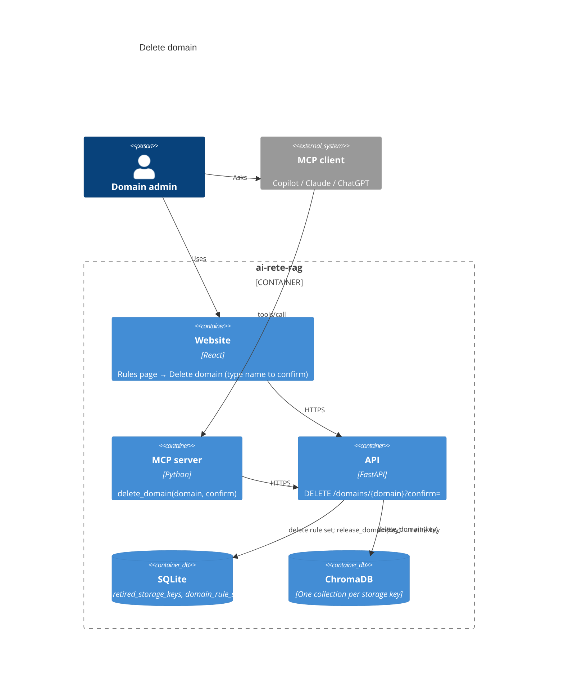

# delete_domain tool

Calls `DELETE /api/v1/domains/{domain}?confirm={domain}` on the ai-rete-rag API. The tool removes the caller's own copy of a domain (rules and documents) and frees its slot in the plan's domain limit. Decision audits are kept, and a domain re-created under the same name starts with a fresh history. The tool is annotated `destructiveHint: true`, and `confirm` must repeat the domain name. The server instructions tell the assistant to delete only after the user confirms which domain.

Requires the API change in zaharajabeen13-create/ai-rete-rag (branch `fix/domain-delete-frees-quota`). Until that change is deployed, the tool returns a 404/405 error from the API.

## C4 — container view

