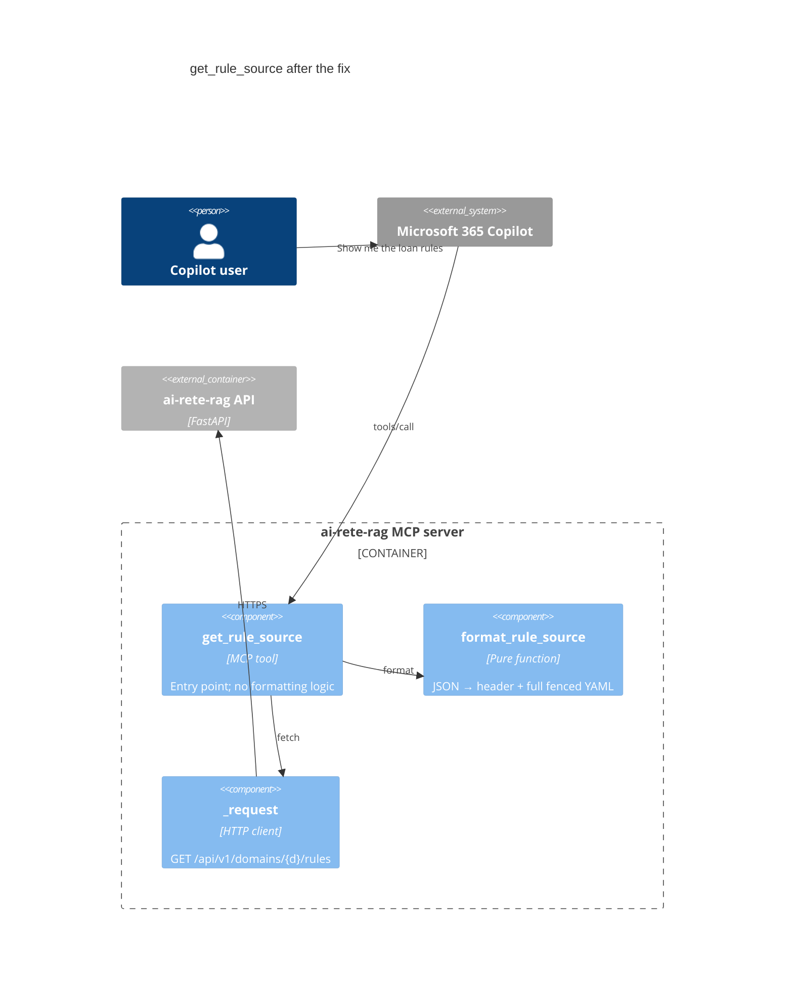

# Teams validation #5971696 — item 6: `get_rule_source` returned partial YAML

**Problem.** In Microsoft 365 Copilot, `get_rule_source` showed only the first
few lines of a domain's YAML. The tool returned the API's JSON verbatim: the YAML
as one escaped string next to the parsed `rules`, `overlaps` and `edges`,
several times the YAML's size. Copilot summarised or cut that reply.

**Fix.** `format_rule_source` (in `ai_rete_rag_mcp/server.py`) turns the response
into a one-line header (rule count, line count, editable, demo) plus the complete
YAML in a single fenced `yaml` block. Errors pass through unchanged. The parsed
view is still available from `list_rules`.

## C4 — component view

SOLID: transport (`_request`) and presentation (`format_rule_source`) stay
separate (SRP). The formatter is a pure function, tested on its own in
`tests/test_rule_source_format.py`.
